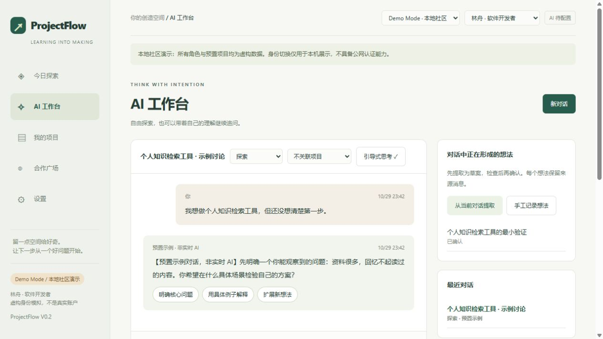
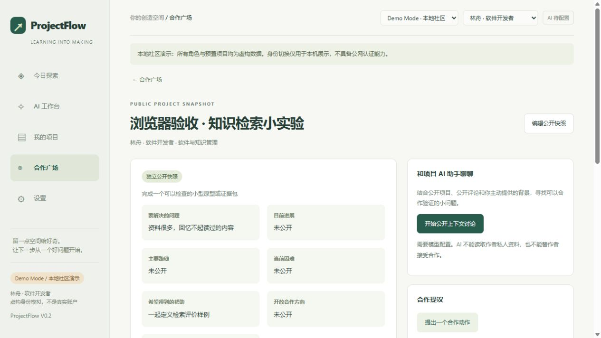

# ProjectFlow V0.2 开发与验收报告

开发开始：2026-10-29；交付日期：2026-10-30（北京时间）。本报告区分实际业务、虚构示例、测试夹具及未验证集成。

## 现有工程检查与复用

任务工作目录最初为空，没有 Git 元数据、用户数据库、README、LICENSE、依赖声明或测试。找到之前交付的 `ProjectFlow-local`：一个单文件 HTML/JavaScript 应用及 Node 本机转发器；数据为浏览器 localStorage，密钥只在页面内存，无 Streamlit、Python 服务或 SQLite 迁移机制。

保留了旧版的绿色纸张视觉、导航/卡片/阅读布局和本地阅读工作流；原 CSS 提取为 `static/legacy-base.css`，新样式在 `style.css` 延续。保留转义文本、正文粘贴、真实 RSS、同源限制、模型超时与失败不冒充成功的设计。原始旧文件与浏览器数据均未修改。

为可靠持久化和清晰的私人/公开边界，替换了无状态 Node 转发器，新增 Python 标准库服务及 SQLite；没有引入前端框架、打包器或全套前端重写。HTML 渲染增加了工作台、项目、任务及社区视图。选择标准库避免额外第三方安装和开源启动成本。

旧版 JSON 迁移为显式、只新增、事务式导入；不复制旧 API 设置或密钥。V0.2 业务数据有 17 张独立实体表（每张有所有者、关联、时间及 JSON 内容）和迁移记录；不是把整个应用状态覆盖进一个 JSON 字段。首次 SQLite 版本为 2；已知旧版本迁移先备份，未知更高版本拒绝写入。

## P0：个人认知与创造

已实现自由聊天、可选模板模式、13 种自然提问模板、六种思考状态、AI 结构化推荐加规则回退、每条回答最多三个方向、手动状态真实影响标签。模板至少一个实质字段即可；可返回自由聊天，原输入被保留到本轮请求，模型失败不会清空草稿。

想法提取产生待检查草案，用户可编辑、确认或拒绝；保存对话 ID 和来源消息 ID。微实验与项目各自保存、编辑和重新打开。项目由想法建立后会关联同一想法的尚未归属项目的微实验。项目目标、条件、认识、路线、不确定性、证据、交付物和下一步均可人工编辑。

讨论可关联选定文章/项目，项目关联回来源对话、想法与实验；用户可以继续纯探索。不会自动把所有聊天变成正式项目。模型提示词与核心字段面向通用创造活动，领域兼容由五种输入的测试覆盖。

## P1：执行与反馈

已实现四种进展状态及不同问题；跟进日期、目标、到期判断、延期/完成/取消；首页和项目页均有入口，仅在应用运行时检查。

项目或独立微实验可生成任务草案，支持本地字段组装和真实模型生成两条明确标注的路径。任务包含背景、目标、上下文、输入、输出、约束、验收标准、禁止操作和确认事项；保存、复制、Markdown 导出、委派状态都实际可用。独立微实验可直接委派，不必自动转为正式项目。

执行结果可手填或通过 TXT/Markdown/JSON 导入，文件内容先形成可检查表单，再保存到任务；路径仅记录，不执行或读取。项目 AI 复盘从已保存的计划、任务、报告开始新私人对话。结果报告不是自动核验证据。每次项目保存都产生版本快照、原因和证据；历史版本不被覆盖。

## P2：阅读与合作广场

真实文章正文/链接管理、RSS/Atom 手动同步、文章去重、已读、收藏、兴趣与阅读讨论可用。模型阅读分析包括核心机制、价值、项目联系与问题。本地每日精选使用透明的关键词/未读排序；不声称具备复杂推荐模型。

来源发现限定为用户网址及最多五个已有源，解析网页声明的 RSS/Atom 并真实请求验证。无全网搜索服务，不生成虚构结果。实际访问 Python 官方博客，发现并验证 `https://blog.python.org/rss.xml`。这只是一个真实站点样本，不保证所有站点或当前网络均可获取。

合作广场有独立公开快照、字段白名单、逐次检查确认、标签/领域文本筛选、公开详情、评论、技术问题/建议、合作提议与作者接受/婉拒。所有互动实际写 SQLite。公开快照无私人项目 ID 或自动同步；私人改动不改变公开快照。

公开 AI 使用独立上下文获取逻辑，仅包含公开白名单字段、最多 50 条公开评论、当前参与者主动输入及其自己的此公开讨论历史；不会读取作者或参与者的私人项目、私人聊天或设置。编辑也不能把公开对话切换为私人上下文。公开 AI 不具有文件访问、数据库工具或代表作者接受合作的权限。

## 示例与无模型体验

`demo.py` 中的四位角色、四个跨领域项目、想法、实验与示例对话均为本项目原创虚构数据，明确标记，不是已有真人成果。真实个人数据位于不同数据库；个人模式默认为空。演示中的新评论、提议、任务与反馈是实际本地交互。

没有 API Key/模型配置时能够浏览、编辑、使用所有模板、管理项目、组装与导出任务、回收结果、评论和提出合作；需要模型的按钮显示配置错误，不伪造回复。`tests/serve_ui_fixture.py` 是开发者必须显式启动的测试程序，独立端口/数据库、界面和每段结果均标明“非真实 AI”；正常启动永远不使用它。

## 环境、密钥与数据保护

使用项目内 `.conda-env`，Python 3.11.18。当前机器 Conda 的 EXE/BAT 启动器存在 DLL 错误，使用同一安装的 `python -m conda` 成功创建项目环境；安装脚本也支持这条路线。未在 base 或其他科研环境安装依赖，未修改全局配置、PATH、驱动或重建其他环境。运行代码只依赖标准库。

GUI 密钥默认只驻留服务内存；可选择原生 Windows Credential Manager 安全保存，不可用时报错，不回退明文。`.env` 为用户管理的可选配置；界面不显示已有完整密钥。密钥不写 SQLite、JSON 导出、模型配置或请求日志。模型 HTTP 错误不回显响应正文。Base URL 不能嵌入账号或查询参数。

服务固定 127.0.0.1，验证 Host、Origin 和 CSRF；静态白名单不暴露 `.env`、数据库与源码。外部内容以文本转义；RSS 限制大小、超时、地址及重定向。SQLite 连接及时关闭。上述措施适用于可信本机环境，不构成互联网社区安全认证。应用业务数据未加密；同步盘可能同步本目录，请自行管理同步与本机权限。

## 验证结果

**32 项自动化测试全部通过**，测试均使用独立临时数据和模拟响应，不调用付费模型：

| 验收范围 | 结果 |
| --- | --- |
| SQLite 初始化、迁移备份、新版本拒绝、持久化 | 通过 |
| 兴趣、对话、想法来源、实验/项目关联 | 通过 |
| 模板选择、输入校验、JSON 解析、推荐回退 | 通过 |
| 任务导出、状态、结果导入、独立实验委派 | 通过 |
| 到期提醒、版本快照与证据 | 通过 |
| 公开字段白名单、私人上下文哨兵隔离 | 通过 |
| 私人数据所有者校验、公开对话范围不可变 | 通过 |
| 评论、合作提议、作者状态权限、演示重置 | 通过 |
| 五种领域讨论到执行任务的数据流程 | 通过 |
| RSS/Atom、本地样例去重、有限发现校验 | 通过 |
| 缺配置、网络失败、GUI 密钥不写明文 | 通过 |
| 实际 loopback HTTP、CSRF/Host、静态路径限制 | 通过 |
| 本地模型 HTTP 协议夹具 | 通过 |

另完成 Python 编译检查、JavaScript 语法检查，以及现有专属环境上的 `setup.ps1` 安装流程验证。原生 Windows Credential Manager 使用随机命名的虚构测试密钥完成写入、读取、删除与删除后空读取检查，测试凭据已移除；受限执行沙箱中安全存储会明确失败，允许访问本机凭据服务后验证成功。

源码包已解压至项目内一次性隔离目录，用当前项目解释器从解压后的源码启动独立服务：首页 HTTP 200，自动初始化 4 个虚构公开项目、4 个身份与 13 个模板。包中不包含运行数据库、`.env`、`.conda-env` 或 QA 数据。这个检查验证源码可独立加载，不等于在第二台全新机器上完成 Conda 安装。

浏览器实际操作：填写模板并检查无模型报错/输入保留；项目字段组装任务并保存；查看 Markdown；手工导入结果；按“遇到困难”保存进展及版本；发布公开快照；切换虚构身份发表评论和合作；切回作者接受；网页刷新、服务进程重启后确认数据仍在。使用明确标记的 UI 测试夹具走通自由聊天 → 模板追问 → 提取/确认想法 → 生成/保存微实验 → 建立项目，并检查来源与实验关联。

测试期间因执行沙箱的临时目录/loopback 限制，测试临时库改置项目内 `tests/.tmp`，HTTP 测试使用允许本机连接的执行权限。没有因此改用其他 Python 环境或调用真实 API。

## 启动、配置与演示

普通用户依次运行 `setup.bat`、`start.bat`。顶部切换 Demo Mode 与虚构身份，按 [五分钟演示指南](../DEMO_GUIDE.md) 展示三幕。GUI 或 `.env` 配置模型；输入真实服务地址与模型名称，应用后测试连接。Windows Credential Manager 通过原生 API，无需额外库。

开发测试命令：`.\.conda-env\python.exe -m unittest discover -s tests -v`。使用 `--data-root .qa` 可将验证数据与正常运行数据隔离。`scripts/package_source.py` 只将白名单源码和文档打包，排除环境、数据库、配置、测试运行数据与私有导出；包内保留 `.env.example`。

## 已知限制与尚未验证

- **未使用真实付费服务商/API Key 验证**。模型协议、本地 HTTP、结构解析、浏览器状态经测试夹具验证；真实语义质量、服务商额度、权限与网络须用用户选择的服务测试。
- 来源发现不含全网搜索接口，阅读精选是简单本地排序；没有付费搜索或复杂学习推荐。
- 没有自主执行 Agent、外部工具自动调度、系统后台通知、流式生成、正式互联网账号、团队同步或公网部署。
- 没有大规模分页/全文检索、并发修改冲突解决、V0.2 JSON 自动恢复、复杂版本差异界面；完整恢复需关闭应用复制数据库。
- 原生安全存储在非 Windows 上不可用；操作系统凭据权限/服务状态可能导致保存失败，此时使用 `.env` 或本次内存密钥。
- 完整批处理“从一台全新电脑安装”尚无第二台机器验证；本机 Conda 创建、中文空格路径、专属解释器及现有环境安装流程已运行。
- 浏览器完成默认桌面宽度的目视验收。窄屏 CSS 已提供，但本次内嵌浏览器的视口覆盖未实际生效，不能声称已在 390px 或真实手机浏览器验收。
- 新增 GitHub Actions 已写好但**尚未在远程 GitHub runner 运行**。当前目录原无仓库；没有擅自初始化远程、推送、修改可见性或公开发布。

## 界面证据

下图仅含虚构演示数据。

